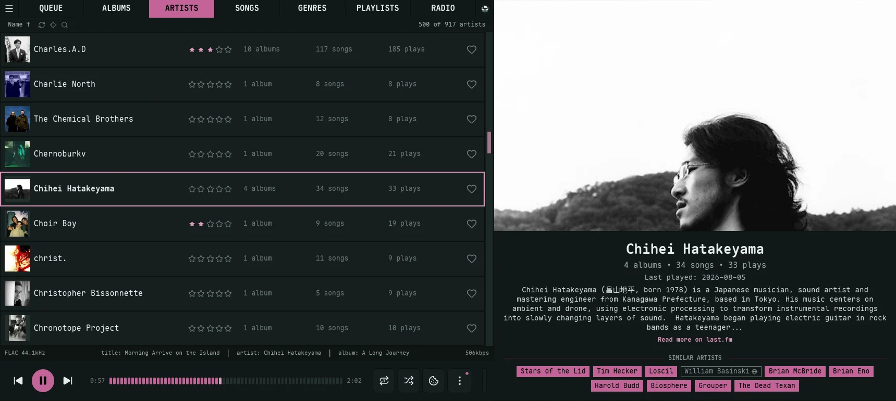
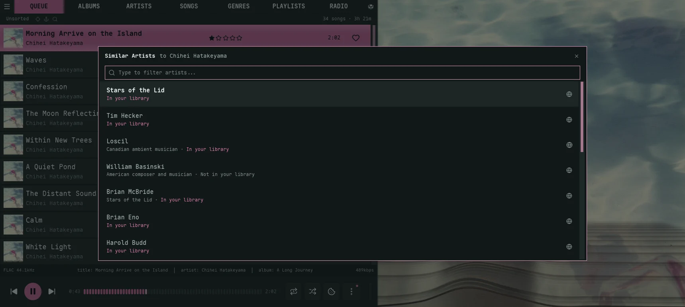

The Artists view shows every artist in your library. Each row shows artwork (or a fallback album cover), name, and stats. The right side shows a large artwork panel with the artist's biography from Navidrome's artist info (usually Last.fm). When the bio comes with a link, a "Read more on ..." line names the site and opens it in your browser. Under the bio sit the artist's [similar artists](#similar-artists), from ListenBrainz.

For navigation, search, multi-select, ratings, and shared right-click actions, see [Library Basics](/guides/library-basics/). For artwork panel sizing, see [Artwork & Performance](/guides/artwork/#the-artwork-panel).

## Sort modes

- **Name** *(default)*, **Favorited**, **Most Played**, **Album Count**, **Song Count**, **Rating**, **Random**

## Album Artists vs. Track Artists

In **Settings → General**, the **Album Artists Only** toggle controls whether collaborators / track-only artists show up in this view. With it on, only artists with explicit album-artist tags appear — keeping the list tighter for libraries with lots of features and one-off contributors.

## Columns

Toggle via the gear icon: **Multi-select**, **Index**, **Thumbnail**, **Stars**, **Album Count**, **Song Count**, **Plays**, and **Love**. Everything but **Multi-select** defaults on.

## Expansion

`Shift + Enter` on an artist (or clicking the "*N* albums" text) expands their albums inline below the row. Only one artist can be expanded at a time; changing sort or search clears the expansion. Expanded album rows offer the standard **Add to Queue / Add to Playlist / Get Info / Show in File Manager** context-menu actions. Artist rows offer the same minus **Show in File Manager** (an artist has no folder of its own), plus **Find Similar** and **Top Songs** (see [Recommendations](#recommendations)).

## Recommendations

Right-clicking an artist row adds two extras beyond the shared menu:

- **Find Similar** — open a panel of tracks like this artist.
- **Top Songs** — the artist's most-played tracks.

Both switch to the Queue view's Similar tab and match against songs already in your library — see [Similar Songs and Top Songs](/guides/queue/#similar-songs-and-top-songs). They act on the artist row only; expanded album rows underneath use the standard menu.

For artists rather than songs, and artists you don't have yet, see [Similar artists](#similar-artists) below.

## Similar artists

Under the biography, the artwork panel lists up to ten artists like the one you're on, straight from [ListenBrainz](https://listenbrainz.org/). Unlike Find Similar, this list isn't limited to your library, so it doubles as a way to find new music.

- **Filled tags** are artists in your library. Click one to jump to them in the Artists view.
- **Outlined tags** with a globe are artists you don't have. Click one to open their ListenBrainz page in your browser.
- An artist you only have as a guest on other people's albums opens in the Songs view, filtered to their songs, since there's no Artists row for them.

Hover a tag to see whether you have that artist, plus MusicBrainz's short note about them when there is one (handy when two artists share a name).

The list needs the artist's MusicBrainz ID, which comes from your files' tags or from Navidrome's artist info. An artist without one gets no list.

### The Similar Artists popup

You don't have to be in the Artists view. Right-click any album, song or artist row (in the library views, the Queue, or the Library Browser's Similar tab) and pick **Similar Artists**. An album or song row uses its artist. Or press `Shift + R` on the highlighted row, and `Shift + R` again to close it.

Type to filter the list. `Enter` or a click on an artist you have jumps to them and closes the popup. Each row's globe button opens the artist's ListenBrainz page, whether you have them or not.

### Privacy

Looking up similar artists sends the artist's MusicBrainz ID to ListenBrainz. It needs no ListenBrainz account or token. To send nothing, turn off **Settings → General → Similar Artists: ListenBrainz** (`similar_artists_online` in [config.toml](/reference/config/#general-settings)). With it off the panel shows no list and the popup says it's turned off.

## Click-through expansion

From an expanded album row, drill into tracks via:

- "*N* songs" text or `Shift + Enter` on a centered child album → Albums view with that album expanded inline at the top.
- **Album** name → Albums view with that album expanded inline at the top.

Collapse with `Shift + Enter`, or change sort to clear the expansion state.
