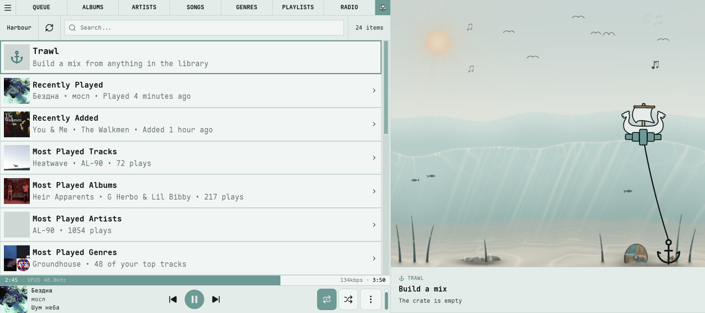

import { Tabs, TabItem } from '@astrojs/starlight/components';

Harbour is Nokkvi's home view and where it opens by default: a landing page of one-press discovery shelves (your recent plays, your newest album, your most-played music), followed by a block of one-press **Random** rows, with a **whole-library search** in the header. It's the one screen that reaches across everything at once, rather than browsing a single entity type.

## Getting to Harbour

Harbour isn't a numbered nav tab. Reach it any of these ways:

- The pinned **longship button** — on the far right of the top nav bar, or at the very bottom of the sidebar when [`nav_layout`](/reference/config/#interface-settings) is `side`.
- The `8` [hotkey](/reference/hotkeys/#views).
- `nokkvi switch-view harbour` from the [CLI](/guides/cli/#view-names).
- On launch: Harbour is the default **start view**. To open somewhere else, set [`start_view`](/reference/config/#general-settings) (Settings → General → **Start View**) to another view.

## Discovery shelves

Under the Trawl row sit six shelves. Each shelf is a single row, and one press (`Enter` or a click) plays it:

| Shelf | One press plays |
| :---- | :-------------- |
| **Recently Played** | Up to **100** of the songs you played last, most recent first |
| **Recently Added** | The album added to your library most recently |
| **Most Played Tracks** | Up to **100** of your most-played songs, most played first |
| **Most Played Album** | Your most-played album |
| **Most Played Artist** | Your most-played artist |
| **Most Played Genre** | Up to **100** random songs from your most-played genre |

Each row shows what it plays: the cover on the left, then the pick's name and its facts, such as the artist, when it was played or added, or its play count. The two song shelves' rows end with how many songs a press plays. `Shift + A` adds the same thing to the queue instead of playing it.

The four **Most Played** shelves stay hidden until there's play history to rank, so on a fresh library they simply don't appear. The [Trawl](/guides/trawl/) mix-builder anchor row always leads the list, above Recently Played, and the [Random block](#the-random-block) closes it out below the last shelf.

### Expandable shelves

Rather browse a shelf than play it? Turn on **Settings → General → Expandable Harbour Shelves** ([`harbour_expandable_shelves`](/reference/config/#general-settings)). Each shelf then becomes a collapsible header over up to **four picks**, and the three single-pick shelves take plural names: Most Played Albums, Most Played Artists and Most Played Genres.

Every shelf starts **collapsed**. Click a header (or center it and press `Enter`) to expand it and reveal its picks; the caret on the right edge of each header points down when open, right when closed. `Shift + Enter` on a pick collapses the shelf it belongs to, so you can close a shelf without arrowing back up to its header. Collapse state lasts for the session: Harbour opens with everything collapsed each launch.

A collapsed header **teases the top pick** the same way a one-press row does: its cover art and a one-line summary. Expand the shelf and the header swaps that teaser for the shelf's own glyph and a pick count (`4 picks`, `1 pick`). Empty shelves read *Nothing here yet*.

Activating a pick plays or opens it the same way it would in its own view. Genre picks are the one twist: playing a genre row here starts **up to 100 random tracks** drawn from that genre rather than the entire backing catalog. `Shift + A` enqueues that same capped draw.

## The Random block

Under the last shelf sit five **Random** rows — one per entity kind, in the nav bar's order:

| Row | One press plays |
| :-- | :-------------- |
| **Random Album** | The album the row is showing |
| **Random Artist** | The artist the row is showing |
| **Random Songs** | A pre-drawn batch of **100** random songs |
| **Random Genre** | **100** songs from the genre the row is showing |
| **Random Playlist** | The playlist the row is showing |

What they play is a random draw: each row **draws its pick when the shelves load** and then previews it, showing the pick's cover on the left and its own facts in the subtitle — an album reads *name • artist • year*, an artist *name • 12 albums*, a playlist *name • 24 songs • 1h 38m*. Press `Enter` and you play exactly what you're looking at, so the row is a preview rather than a lottery ticket. `Shift + A` adds that same pick to the queue instead.

**Refresh re-rolls every row.** The `R` [hotkey](/reference/hotkeys/#sort--view) — or the refresh button in the Harbour header — reloads the shelves and draws a fresh pick for each Random row.

Until a pick lands, a row shows its entity glyph and names what a press would do (*Play a random album*, *Play 100 songs from a random genre*). Draws skip playlists and genres with no songs, so a press never lands on something empty; a row whose draw didn't land at all says so instead of playing.

## The artwork preview

Harbour borrows the large horizontal [artwork column](/guides/artwork/#the-artwork-panel) and drives it from whatever you've centered:

- Center an **album or track** and its full-size cover fills the column.
- Center a **shelf** and the panel previews its top pick: the pick's cover under a pill with the shelf's name and the pick's facts. The Most Played Genre shelf shows a cover collage of that genre instead.
- Center a **playlist or genre** in search results or an expanded shelf and Nokkvi builds a **cover collage** (up to a 3×3 grid) from the items inside. A playlist with its own uploaded cover shows that instead.
- Center a **Random row** and the panel previews its pre-drawn pick under a quiet pill — `RANDOM`, the entity noun, and the pick's facts. A row with nothing drawn yet shows the pill over a blank square.
- Center the **Trawl row** — where Harbour first opens — and the panel comes alive instead: the nokkvi longship sails a rippling sea, endlessly dragging its anchor behind it. That's *trawling*, the mix-builder's namesake; the crate's current size and blend ride in the pill on top.

So arrowing down the shelves is also a way to flip through cover art, one centered item at a time.

The Trawl scene follows your **theme**, not the clock: dark themes give it a night sea under stars, an aurora, and a moon, with the occasional shooting star; light themes give it a daylit sea with the sun and gliding seagulls. Leaping fish, little drifting music notes, and a half-buried viking shield on the seabed show up in both. It runs on its own, no music required, and the boat itself is the [visualizer's surfing boat](/reference/visualizer/#surfing-boat) at a slow cruise.

While music plays, the night sky moves with it: the aurora's rays rise and fall with the track, each kick sends a surge of light across it, and the stars flare on the beat. This works with the visualizer off too.

<Tabs syncKey="trawl-scene">
  <TabItem label="Night (dark themes)">
    
  </TabItem>
  <TabItem label="Day (light themes)">
    
  </TabItem>
</Tabs>

## Whole-library search

The search box in the Harbour header searches your **entire library at once** — the only search in Nokkvi that isn't scoped to a single view. Type at least two characters and results come back grouped by type, in this order:

**Artists · Albums · Songs · Genres · Playlists**

Each group is a preview of up to eight matches (a group at the cap reads **"8+ matches"**). Groups never interleave — each stays under its own header. Every group header carries a **See all**: click it to jump to that entity's full view with your query already applied as its filter, so you can keep narrowing from there.

Clear the search (or delete back under two characters) and Harbour returns to the shelves.
